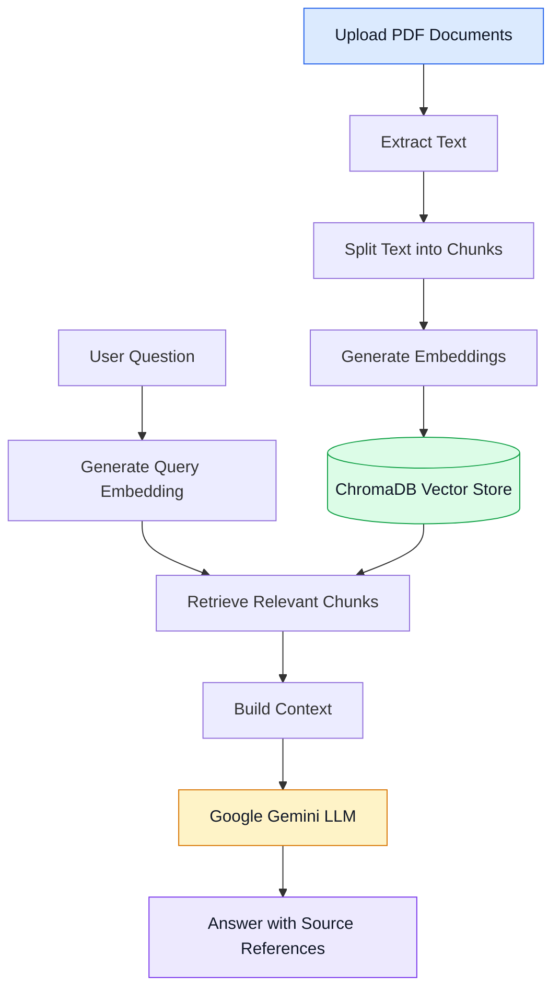

# 📚 RAG Document Q&A Chatbot

A **Retrieval-Augmented Generation (RAG)** application that allows users to upload PDF documents and ask questions about their contents. The application retrieves relevant document passages and uses Google Gemini to generate context-aware answers with source references.

## 🚀 Features

- **Multi-PDF Upload:** Upload PDF documents through an interactive Gradio interface.
- **Document Processing:** Extract text from PDFs and split it into smaller, overlapping chunks.
- **Semantic Embeddings:** Generate vector embeddings using Hugging Face Sentence Transformers.
- **Vector Storage:** Store and search document embeddings using ChromaDB.
- **Context-Aware Q&A:** Retrieve relevant document passages and generate answers using Google Gemini.
- **Source References:** Display document source information to help users trace answers to the original content.
- **Page-Specific Retrieval:** Retrieve content associated with requested PDF pages.
- **Interactive Interface:** Ask questions and view responses through a Gradio web interface.

## 🏗️ Architecture

The application follows a typical Retrieval-Augmented Generation workflow.



### How It Works

1. **Document ingestion:** The user uploads PDF documents through the Gradio interface.
2. **Text extraction:** LangChain's PDF loader extracts text from the uploaded documents.
3. **Chunking:** The extracted text is divided into smaller, overlapping chunks to support retrieval.
4. **Embedding generation:** Hugging Face Sentence Transformers converts the chunks into vector embeddings.
5. **Vector storage:** ChromaDB stores the embeddings and associated document metadata.
6. **Retrieval:** The application searches for document chunks relevant to the user's question.
7. **Answer generation:** The retrieved context is passed to Google Gemini, which generates a response.
8. **Source references:** The application presents source information alongside the answer.

## 🛠️ Tech Stack

| Technology                         | Purpose                                                   |
| ---------------------------------- | --------------------------------------------------------- |
| Python                             | Application logic                                         |
| Gradio                             | Interactive web interface                                 |
| LangChain                          | Document loading, chunking, and LLM integration           |
| ChromaDB                           | Vector storage and similarity search                      |
| Hugging Face Sentence Transformers | Local embedding generation                                |
| Google Gemini API                  | Context-aware answer generation                           |
| PyPDF                              | PDF text extraction through the document-loading pipeline |

## 📂 Project Structure

```text
RAG-Document-QA-Chatbot/
├── app.py              # Gradio application and user interface
├── rag_pipeline.py     # Document processing, retrieval, and generation
├── requirements.txt    # Python dependencies
├── README.md           # Project documentation
└── .gitignore          # Files excluded from version control
```

## ⚙️ Setup and Installation

### Prerequisites

- Python installed on your system
- Git
- A Google Gemini API key

### 1. Clone the repository

Replace the placeholder with your actual GitHub repository URL.

```bash
git clone https://github.com/AmiteshBatham15/RAG-Document-QA-Chatbot.git
cd RAG-Document-QA-Chatbot
```

### 2. Create a virtual environment

```bash
python -m venv .venv
```

Activate it on Windows using PowerShell:

```powershell
.venv\Scripts\Activate.ps1
```

### 3. Install dependencies

```bash
python -m pip install -r requirements.txt
```

### 4. Configure environment variables

Create a `.env` file in the project root directory:

```env
GOOGLE_API_KEY=your_api_key_here
```

Replace the placeholder with your own API key.

**Security:** Never commit your actual API key to GitHub. Keep `.env` excluded through `.gitignore`.

### 5. Run the application

```bash
python app.py
```

Open the local URL displayed in the terminal to access the chatbot.

## 🔐 Security and Best Practices

- Keep API keys and other secrets out of version control.
- Do not commit virtual environments, generated vector databases, or Python cache files.
- Avoid uploading confidential documents to a public or externally hosted application.
- Ensure you have permission to process and share uploaded documents.
- Configure API credentials securely when deploying the application.

## 🔮 Future Improvements

Potential enhancements include:

- Conversation history and chat reset functionality
- Improved retrieval using configurable top-k results and relevance filtering
- Support for additional document formats
- Automated tests for document processing and retrieval
- Evaluation of retrieval quality and answer accuracy
- Deployment through Hugging Face Spaces
- Improved source citations with document filenames and page numbers

## 👨‍💻 Project Goal

This project demonstrates a practical implementation of a RAG pipeline that combines semantic search, vector databases, document processing, and large language models to answer questions grounded in uploaded documents.

It explores how retrieval-based context can make document Q&A more useful than relying on an LLM's general knowledge alone.
