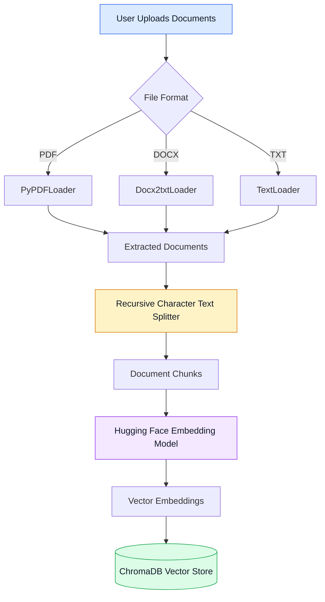
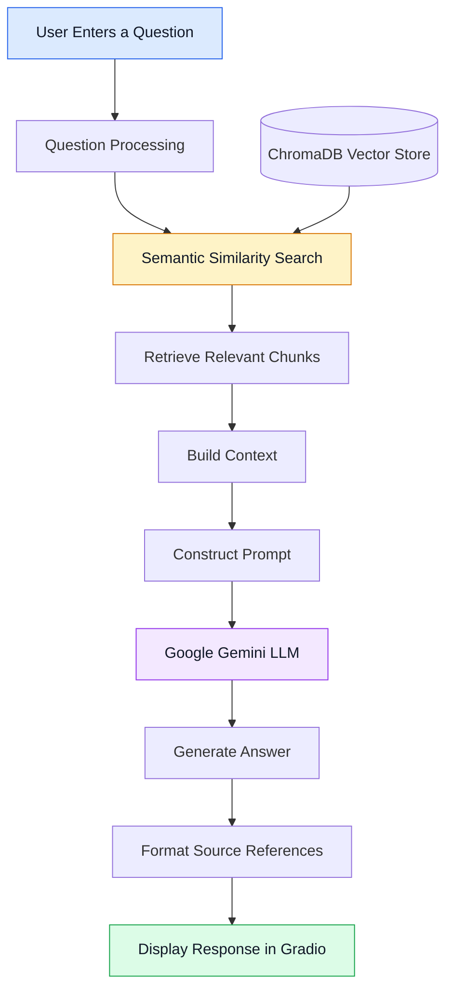

# 📚 RAG Document Q&A Chatbot

### An AI-Powered Document Question Answering System Using Retrieval-Augmented Generation


## 📖 Overview

The **RAG Document Q&A Chatbot** is an AI-powered application that allows users to upload documents and ask natural-language questions about their content.

The application combines **Retrieval-Augmented Generation (RAG)**, semantic search, vector embeddings, and a Large Language Model (LLM) to generate answers grounded in retrieved document content.

Instead of relying entirely on the language model's general knowledge, the system retrieves relevant passages from uploaded documents and supplies them as context when generating an answer.

The application currently supports **PDF, Microsoft Word (DOCX), and plain-text (TXT) files** through an interactive Gradio interface.

This project demonstrates the practical integration of document processing, vector databases, embedding models, retrieval workflows, prompt engineering, and LLM-based question answering.

## 🎯 Project Objectives

The primary objectives of this project are:

- Build an interactive chatbot that answers questions about user-uploaded documents.
- Implement a complete Retrieval-Augmented Generation pipeline.
- Extract and process content from multiple document formats.
- Convert document chunks into numerical vector embeddings.
- Store and retrieve document representations using ChromaDB.
- Use semantic similarity search to identify relevant information.
- Generate contextual answers using Google Gemini.
- Display source references to improve answer traceability.
- Provide a simple, accessible interface for interacting with documents.

## ✨ Key Features

### 📄 Multi-Format Document Support

Upload documents in the following formats:

- PDF (`.pdf`)
- Microsoft Word (`.docx`)
- Plain text (`.txt`)

### 🔍 Semantic Search

The system retrieves document chunks based on semantic similarity rather than relying only on exact keyword matches.

### 🤖 LLM-Powered Question Answering

Google Gemini generates responses using the context retrieved from the uploaded documents.

### 🧠 Vector Embeddings

The application uses the `sentence-transformers/all-MiniLM-L6-v2` embedding model to represent document chunks as vectors.

### 🗄️ Vector Database

ChromaDB stores the document chunks and their embeddings for similarity-based retrieval.

### 💬 Interactive Chat Interface

Gradio provides a user-friendly interface for uploading documents, processing files, and asking questions.

### 📑 Source References

Answers can include source filenames and PDF page references when that metadata is available.

### 📌 Page-Specific PDF Questions

The retrieval pipeline includes logic for questions that reference a particular PDF page.

### 🔐 Environment-Based API Configuration

Google Gemini credentials are loaded from environment variables rather than hardcoded into application source files.

## 🏗️ System Architecture

The application follows a Retrieval-Augmented Generation architecture with two primary workflows: document ingestion and question answering.

### 1. Document Ingestion Pipeline

This stage processes uploaded files and prepares them for retrieval.



**Pipeline explanation:**

1. The user uploads one or more documents.
2. The application identifies each file's extension.
3. The corresponding loader extracts the document text.
4. `RecursiveCharacterTextSplitter` divides the text into smaller chunks.
5. The embedding model converts each chunk into a vector.
6. ChromaDB stores the chunks, embeddings, and associated metadata.

### 2. Question Answering Pipeline

This stage retrieves relevant content and generates an answer.



**Pipeline explanation:**

1. The user submits a natural-language question.
2. The application searches the vector store for relevant document chunks.
3. The retrieved chunks are assembled into a context.
4. The context and question are included in a prompt.
5. Google Gemini generates an answer based on the supplied context.
6. The application displays the response and available source references.

## 🔄 How Retrieval-Augmented Generation Works

Retrieval-Augmented Generation combines information retrieval with language generation.

A conventional LLM answers using its learned knowledge and the context provided in its prompt. A RAG system first retrieves relevant information from an external knowledge source and then uses that information to generate an answer.

The workflow can be represented as:

\[
\text{Answer} = \text{LLM}(\text{Question}, \text{Retrieved Context})
\]

The retrieval process can be expressed as:

\[
D_k = \operatorname{TopKSimilarity}(q, D)
\]

Where:

- \(q\) represents the user's question.
- \(D\) represents the collection of document chunks.
- \(D_k\) represents the retrieved chunks most similar to the question.

In this project, the embedding model represents text numerically, and ChromaDB performs similarity-based retrieval.

The retrieved content is then passed to Google Gemini to generate a response.

### Why Use RAG?

- It allows the application to work with user-provided documents.
- It supplies relevant external context to the language model.
- It can reduce unsupported answers when the prompt requires grounding in retrieved content.
- It provides a practical way to build document question-answering systems without training a new language model from scratch.

RAG does not guarantee perfect accuracy. Results still depend on document extraction, chunking, retrieval quality, and the model's response.

## 🛠️ Technology Stack

| Technology                         | Role in the Project                     |
| ---------------------------------- | --------------------------------------- |
| Python                             | Main programming language               |
| Gradio                             | Web-based user interface                |
| LangChain                          | Document processing and LLM integration |
| PyPDFLoader                        | PDF text extraction                     |
| Docx2txtLoader                     | DOCX text extraction                    |
| TextLoader                         | TXT text extraction                     |
| RecursiveCharacterTextSplitter     | Splits documents into chunks            |
| Hugging Face Sentence Transformers | Generates text embeddings               |
| `all-MiniLM-L6-v2`               | Embedding model                         |
| ChromaDB                           | Vector storage and similarity search    |
| `ChatGoogleGenerativeAI`         | Connects LangChain to Google Gemini     |
| Google Gemini API                  | Generates contextual answers            |
| python-dotenv                      | Loads environment variables             |

## 🧩 Core Components

### 1. Document Loaders

The application selects a document loader based on the file extension.

| Loader             | Supported Input          |
| ------------------ | ------------------------ |
| `PyPDFLoader`    | PDF documents            |
| `Docx2txtLoader` | Microsoft Word documents |
| `TextLoader`     | Plain-text documents     |

The extracted content is represented as LangChain documents, allowing the subsequent processing steps to use a common format.

### 2. Text Splitting

The project uses `RecursiveCharacterTextSplitter` to divide extracted text into manageable chunks.

Current configuration:

| Parameter     |            Value |
| ------------- | ---------------: |
| Chunk size    | 2,000 characters |
| Chunk overlap |   200 characters |

**Why chunking matters**

- It keeps individual context passages manageable.
- It allows the retriever to locate relevant sections rather than always passing an entire document.
- Overlapping chunks help preserve context near chunk boundaries.
- It helps control the amount of information sent to the language model.

These values are configuration choices, not universal optimal settings. Different document types may benefit from different chunk sizes.

### 3. Embedding Model

The application uses:

`sentence-transformers/all-MiniLM-L6-v2`

The embedding model transforms text into numerical vectors that capture semantic relationships between passages.

Semantically similar text can have similar vector representations even when it does not use exactly the same words.

### 4. ChromaDB Vector Store

ChromaDB stores the embedded chunks and associated metadata.

During question answering, the application queries the vector store to retrieve chunks that are semantically similar to the user's question.

The metadata also helps the application identify source filenames and available PDF page information.

### 5. Google Gemini

The project integrates Google Gemini through LangChain's `ChatGoogleGenerativeAI` wrapper.

The model receives the user's question and the retrieved document context, then generates a natural-language answer.

The prompt is designed to encourage the model to use the supplied context and acknowledge when the available information is insufficient.

### 6. Gradio Interface

Gradio provides the user-facing application.

The interface includes:

- A multi-file document uploader.
- A document-processing button.
- Processing status and uploaded-file information.
- A chat interface for questions and answers.
- Example prompts to help users get started.

## 📂 Project Structure

```text
RAG-Document-QA-Chatbot/
│
├── app.py
│   └── Gradio interface, file uploads, processing status, and chat
│
├── rag_pipeline.py
│   └── Document loading, chunking, embeddings, retrieval, and answers
│
├── requirements.txt
│   └── Project dependencies
│
├── README.md
│   └── Project documentation
│
├── .env
│   └── Local API credentials (excluded from Git)
│
├── .gitignore
│   └── Files and directories excluded from version control
│
└── .venv/
    └── Local Python virtual environment (excluded from Git)
```

The `.env` file and `.venv` directory are local development resources. They should not be committed to a public repository.

## ⚙️ Installation and Setup

Follow these steps to run the project locally.

### Prerequisites

Install the following:

- Python compatible with the project's dependencies.
- Git.
- Visual Studio Code or another Python editor.
- A Google Gemini API key.

### Step 1: Clone the Repository

```bash
git clone https://github.com/AmiteshBatham15/RAG-Document-QA-Chatbot.git
cd RAG-Document-QA-Chatbot
```

Replace `YOUR_GITHUB_REPOSITORY_URL` with the actual URL of your GitHub repository.

### Step 2: Create a Virtual Environment

```bash
python -m venv .venv
```

A virtual environment keeps the project's Python dependencies separate from other Python projects.

### Step 3: Activate the Virtual Environment

On Windows:

```powershell
.venv\Scripts\Activate.ps1
```

Alternatively, in Command Prompt:

```bat
.venv\Scripts\activate.bat
```

### Step 4: Install Dependencies

```bash
python -m pip install -r requirements.txt
```

If the DOCX loader dependency is missing, install it with:

```bash
python -m pip install docx2txt
```

### Step 5: Configure Environment Variables

Create a `.env` file in the project root directory.

Add your Google Gemini API key:

```env
GOOGLE_API_KEY=your_google_api_key_here
```

Replace the placeholder with your own key.

Keep this file private. Never paste a real API key into the README, source code, screenshots, or public GitHub commits.

### Step 6: Start the Application

```bash
python app.py
```

Once the application starts, open the local Gradio URL displayed in the terminal.

## 💬 Using the Application

### Step 1: Upload Documents

Upload one or more files in PDF, DOCX, or TXT format.

### Step 2: Process Documents

Click the document-processing button and wait for the application to load the text, split it into chunks, generate embeddings, and create the vector store.

### Step 3: Ask Questions

Enter a question in the chat interface.

Example questions:

- What is the main topic of this document?
- Explain the objectives of the project.
- What are the key points discussed in the document?
- What information is available on page 5?
- Find the section that discusses the system architecture.
- Compare the information contained in the uploaded documents.

### Step 4: Review the Answer

The application returns a generated answer based on the retrieved context and displays available source references.

For the best results, ask clear, specific questions and upload documents containing the information you want to retrieve.

## 📌 Source References and Page-Level Retrieval

Source metadata helps connect generated answers to the documents used during retrieval.

For PDF documents, page metadata can be used to display a page reference. DOCX and TXT documents are identified by filename when page metadata is unavailable.

The retrieval pipeline also includes logic for questions that explicitly mention a PDF page.

Page-specific retrieval depends on the document metadata and the vector database's filtering behavior. It should not be treated as a guarantee that every answer is derived exclusively from one page.

## 🧪 Example Use Cases

This project can be adapted for:

- **Academic research:** Ask questions about research papers and project reports.
- **Study assistance:** Retrieve definitions, explanations, and key concepts from notes.
- **Technical documentation:** Search manuals and technical documents.
- **Business documents:** Extract relevant information from reports and text files.
- **Knowledge retrieval:** Build a conversational interface over a collection of documents.

These are potential applications of the underlying workflow, not claims that the current version includes specialized features for each domain.

## 🔐 Security Considerations

API credentials and user documents should be handled carefully.

- Store API keys in environment variables.
- Exclude `.env` from version control.
- Exclude `.venv` and other unnecessary generated files.
- Do not commit private or confidential documents.
- Review Git changes before pushing to a public repository.
- Avoid logging sensitive document content unnecessarily.

Example `.gitignore` entries:

```gitignore
.env
.venv/
__pycache__/
*.py[cod]
.pytest_cache/
```

Adjust `.gitignore` to match your actual project structure and any files you intend to keep private.

## ⚠️ Current Limitations

The current implementation has some practical limitations:

- **Retrieval coverage:** Normal question answering retrieves a limited number of relevant chunks, so it may not include every section of a long document.
- **Document-wide summaries:** A broad summarization request may not cover the entire document unless a dedicated summarization workflow is implemented.
- **Extraction quality:** Scanned PDFs and complex layouts may require OCR or additional preprocessing.
- **Page references:** Page-level references are primarily available for PDFs with appropriate metadata.
- **Context limitations:** The amount of retrieved content that can be processed at once is limited by the model's context window and API constraints.
- **Answer quality:** The system can still produce incomplete or incorrect answers if relevant information is missing, poorly extracted, or not retrieved.
- **Storage:** The current vector-store workflow builds a store when documents are processed. Persistence across application restarts depends on whether persistent storage is configured.
- **Evaluation:** Retrieval quality and answer faithfulness have not been established by a formal evaluation benchmark.

## 🚀 Future Enhancements

Potential next steps include:

### Retrieval Improvements

- Improve retrieval accuracy with metadata filtering and query refinement.
- Experiment with different chunk sizes and overlap settings.
- Add hybrid search combining keyword and semantic retrieval.
- Explore reranking retrieved chunks.

### Summarization

- Implement document-wide summarization across all chunks.
- Generate separate summaries for multiple uploaded files.
- Support structured summaries with key points, conclusions, and important terms.

### User Experience

- Improve source citations and document references.
- Add conversation memory for follow-up questions.
- Support streaming responses.
- Improve error messages and document-processing feedback.

### Storage and Deployment

- Add persistent vector storage.
- Support larger document collections.
- Deploy the application to a cloud platform.
- Add authentication if the application is exposed to multiple users.

### Evaluation

- Create a test set of questions and expected answers.
- Measure retrieval relevance and answer faithfulness.
- Test the effect of chunk size, overlap, and retrieval count.

## 📈 Learning Outcomes

This project provides practical experience with:

- Retrieval-Augmented Generation architecture.
- Large Language Model integration.
- Document ingestion and text preprocessing.
- Semantic search and vector embeddings.
- Vector databases and similarity retrieval.
- Prompt engineering and context-grounded generation.
- LangChain components and document metadata.
- Building interactive AI applications with Gradio.
- Managing API credentials through environment variables.
- Organizing and documenting a Python project for GitHub.

## 🤝 Contributing

Contributions and improvements are welcome.

1. Fork the repository.
2. Create a feature branch.
3. Implement and test your changes.
4. Commit your changes with a descriptive message.
5. Open a pull request describing the improvement.

Please do not include API keys or confidential documents in contributions.

## 📜 License

No license is specified by this README. Add a `LICENSE` file if you intend to distribute the project under a particular open-source license.

## 👨‍💻 Author

Developed as a hands-on project exploring Retrieval-Augmented Generation, Large Language Models, semantic search, vector databases, and AI-powered document question answering.

---

**If you find this project useful, consider giving the repository a star ⭐.**
